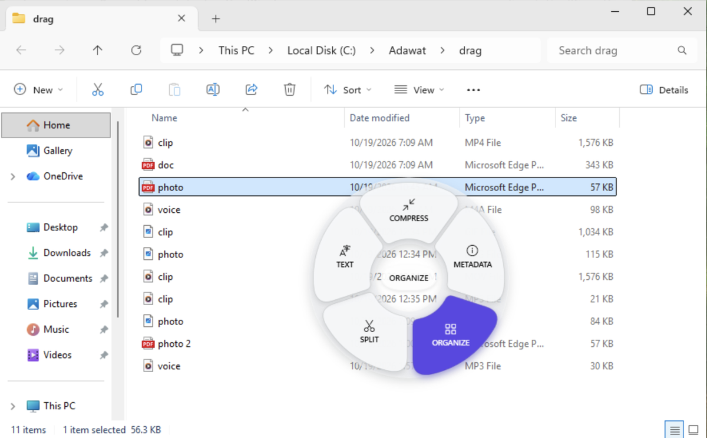
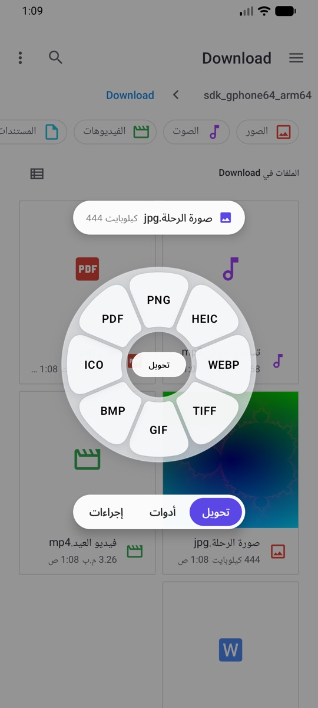
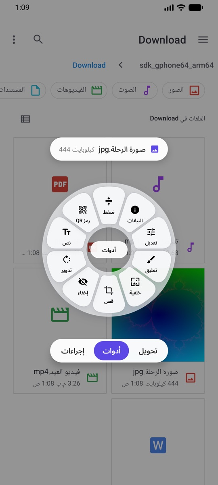
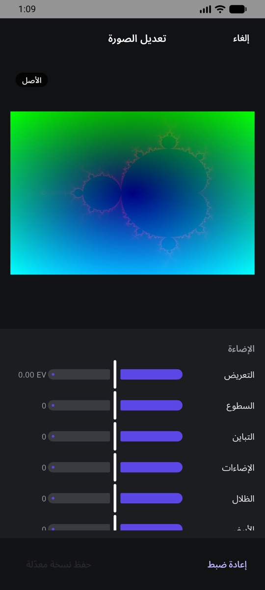
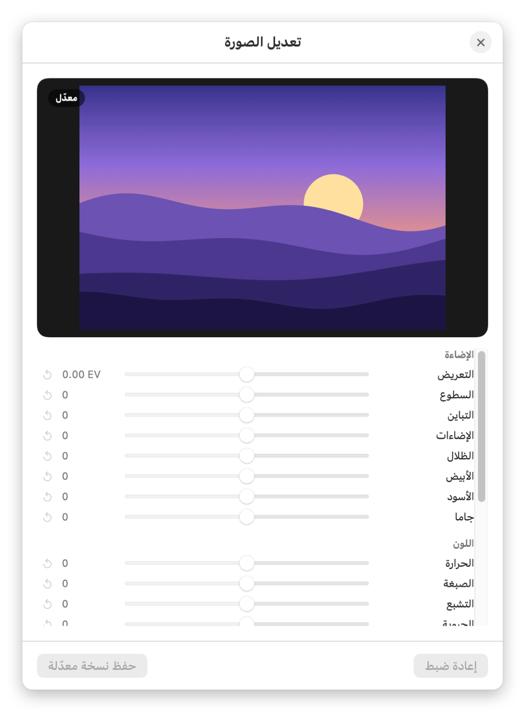
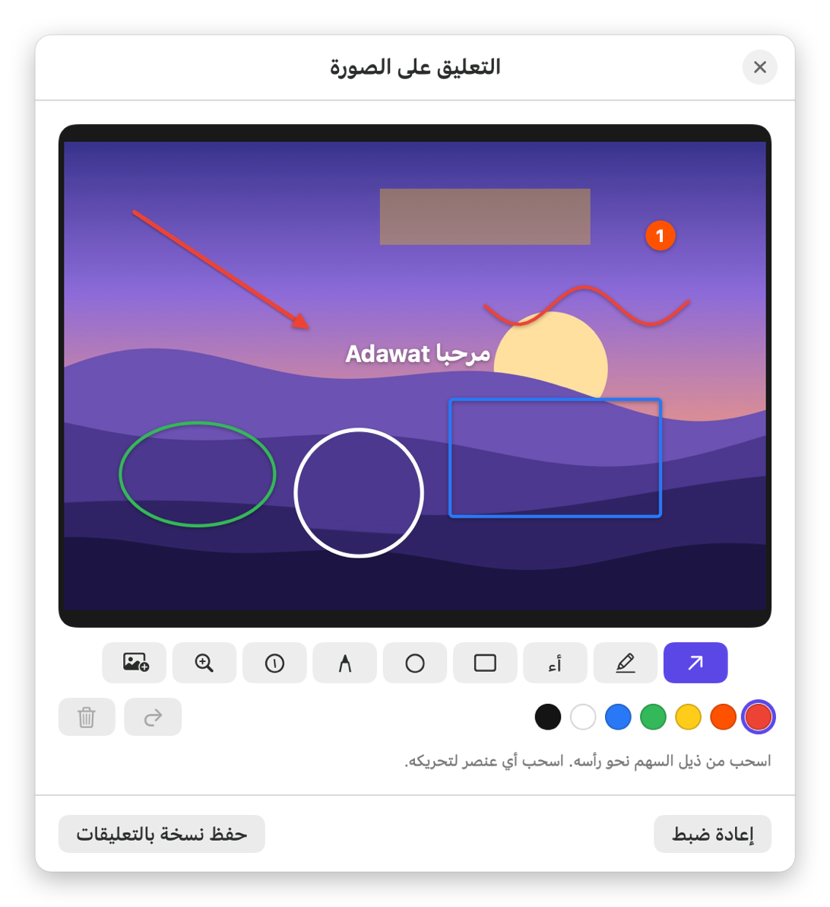
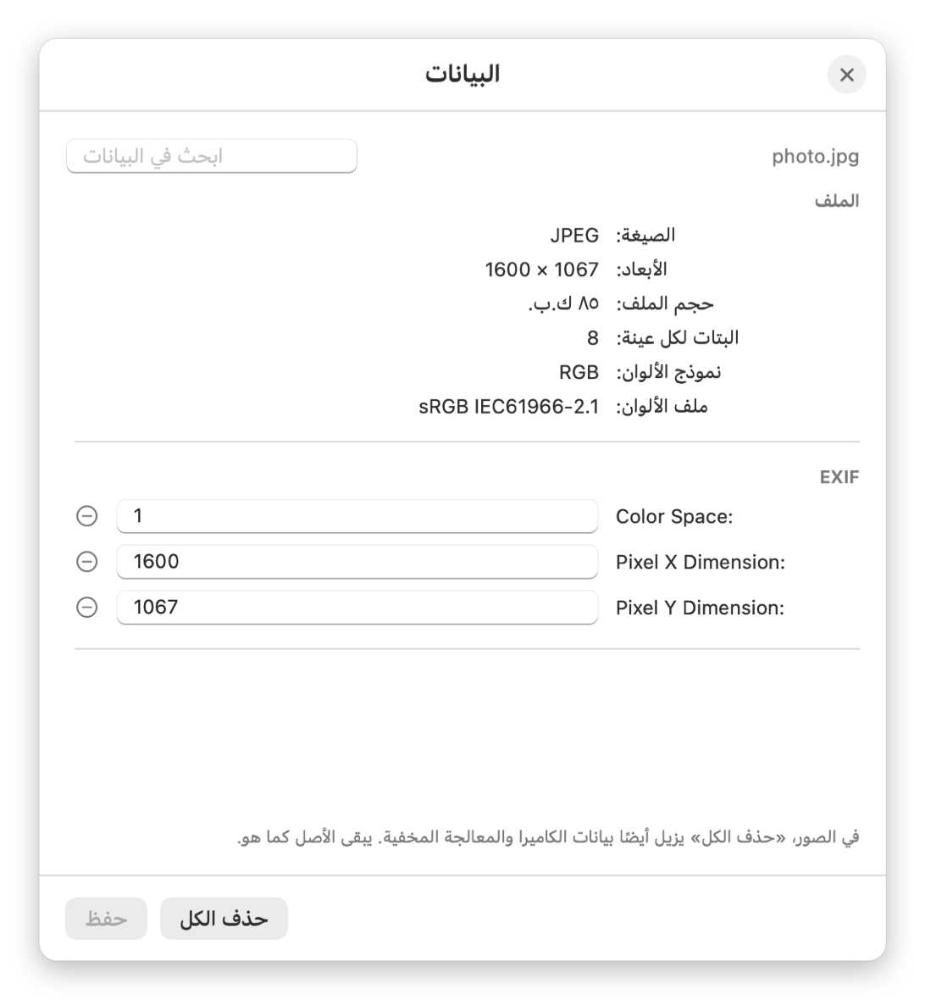

<p align="center">
  <picture>
    <source media="(prefers-color-scheme: dark)" srcset="docs/media/banner-dark.png">
    
  </picture>
</p>

<p align="center">
  <a href="README.md">English</a> · <b>العربية</b>
</p>

<p align="center">
  <a href="https://www.youtube.com/@motalim-ai?sub_confirmation=1"></a>
</p>

<p align="center">
  <a href="https://github.com/motalim-ai/adawat/releases/latest"></a>
  
  
  
  
  <a href="LICENSE"></a>
</p>

---

<div dir="rtl">

**أدوات** تطبيق صغير بيعيش في شريط القوائم على الماك، أو جنب الساعة على الويندوز، أو في الشريط اللي فوق على اللينكس. ابدأ اسحب أي ملف، واضغط
مفتاح، فتظهر عجلة اختيارات تحت الماوس على طول. أفلت الملف على الاختيار اللي عاوزه وخلاص: صيغة جديدة، أو حجم أصغر، أو نسخة معدّلة.
من غير رفع ملفات، ومن غير حساب، ومن غير حد استخدامات. كل حاجة بتحصل على جهازك.
وعلى الأندرويد، شارك أي ملف لأدوات وهتفتح نفس العجلة.

</div>

<p align="center">
  
</p>

<div dir="rtl">

## التثبيت

> **شرح بالفيديو ونصايح وأدوات جديدة:** على [قناة متعلم على يوتيوب](https://www.youtube.com/@motalim-ai?sub_confirmation=1).

### الماك

1. حمّل **[Adawat.dmg](https://github.com/motalim-ai/adawat/releases/latest/download/Adawat.dmg)** من آخر إصدار.
2. افتحه واسحب **Adawat** لمجلد **Applications**.
3. افتح **Adawat** من Applications. هتظهر رسالة *"Adawat" Not Opened*. اضغط **Done**، ومتضغطش Move to Trash.
4. افتح **إعدادات النظام (System Settings) ← الخصوصية والأمان (Privacy & Security)**، وانزل لتحت لحد جزء
   **Security**، واضغط **Open Anyway** جنب جملة *"Adawat" was blocked to protect your Mac*.
5. اضغط **Open Anyway** تاني، واكتب باسورد الماك. التطبيق هيفتح، ومش هيسألك تاني خالص.
6. هتلاقي أيقونة العجلة في شريط القوائم، ودليل البداية بيخليك تجرّب مرة.

</div>

<details dir="rtl">
<summary>بتحب Terminal؟ أمر واحد بيعمل الخطوات من 3 لـ 5</summary>

```bash
xattr -dr com.apple.quarantine /Applications/Adawat.app && open /Applications/Adawat.app
```

</details>

<div dir="rtl">

**ليه الماك بيسأل؟** لأن أدوات لسه مش موثّق من أبل، فالماك بيسأل مرة واحدة قبل ما يفتح أي برنامج متحمّل من
برا App Store. والتطبيق مفتوح المصدر: تقدر تقرا كل سطر فيه هنا، أو تبنيه بنفسك.
وعلى macOS 14 Sonoma، طريقة **كليك يمين ← Open ← Open** بتشتغل كمان.

محتاج macOS 14 Sonoma أو أحدث على أجهزة Apple silicon.

### الويندوز

1. حمّل ملف التثبيت المناسب لجهازك من آخر إصدار:
   - **[Adawat-Setup-x64.exe](https://github.com/motalim-ai/adawat/releases/latest/download/Adawat-Setup-x64.exe)** لمعظم الأجهزة (Intel أو AMD).
   - **[Adawat-Setup-arm64.exe](https://github.com/motalim-ai/adawat/releases/latest/download/Adawat-Setup-arm64.exe)** لأجهزة ARM (زي Snapdragon و Surface Pro X).

   مش متأكد؟ افتح **الإعدادات ← النظام ← حول (Settings ← System ← About)** وبص على **نوع النظام (System type)**.
2. افتح ملف التثبيت. لو الويندوز قالك *Windows protected your PC*، اضغط **More info** وبعدين **Run anyway**.
   ولو المتصفح قالك إن الملف مش بيتحمّل كتير، اختار **Keep**.
3. اختار **العربية** أو **English**، وبعدين **التالي** و **تثبيت**. مش محتاج باسورد المسؤول، لأن أدوات بيتثبت
   على حسابك انت بس.
4. أدوات هيشتغل جنب الساعة (لو الأيقونة مستخبية، دوّر تحت السهم **^**)، ودليل البداية بيخليك تجرّب مرة.

**ليه الويندوز بيحذّر؟** لأن ملف التثبيت لسه مش موقّع رقميًا، فـ SmartScreen مش عارفه. والتطبيق مفتوح المصدر،
وبصمة SHA-256 لكل ملف تثبيت مكتوبة في صفحة الإصدار.

محتاج Windows 10 (إصدار 1809) أو Windows 11، نسخة 64 بت. وتقدر تشيله في أي وقت من **الإعدادات ← التطبيقات**.

### اللينكس

حمّل الملف المناسب لتوزيعتك من آخر إصدار. كل ملف موجود لمعظم الأجهزة (x64) ولأجهزة ARM64.

| التوزيعة | التحميل | التثبيت |
| --- | --- | --- |
| Ubuntu و Debian و Linux Mint و Pop!_OS | [Adawat-linux-amd64.deb](https://github.com/motalim-ai/adawat/releases/latest/download/Adawat-linux-amd64.deb) | دوس عليه مرتين، أو `sudo apt install ./Adawat-linux-amd64.deb` |
| Fedora و openSUSE | [Adawat-linux-x86_64.rpm](https://github.com/motalim-ai/adawat/releases/latest/download/Adawat-linux-x86_64.rpm) | `sudo dnf install ./Adawat-linux-x86_64.rpm` |
| أي توزيعة تانية | [Adawat-x86_64.AppImage](https://github.com/motalim-ai/adawat/releases/latest/download/Adawat-x86_64.AppImage) | خليه قابل للتشغيل (`chmod +x`) وافتحه. مش محتاج تثبيت. |

ملفات ARM64 آخرها `Adawat-linux-arm64.deb` و `Adawat-linux-aarch64.rpm` و `Adawat-aarch64.AppImage`. وملفات .deb و .rpm بتثبّت كمان البرامج اللي
أدوات بيقرا بيها النص وبيعمل بيها المستندات (Tesseract و WeasyPrint و LibreOffice)، أما مع الـ AppImage فأدوات
بيقولك تثبّت إيه أول ما أداة تحتاجه.

1. افتح **أدوات** من التطبيقات. أيقونته هتظهر في الشريط اللي فوق، ودليل البداية بيخليك تجرّب مرة.
2. **GNOME على Wayland** (Ubuntu و Fedora وأغلب التوزيعات دلوقتي): اعمل تسجيل خروج ودخول مرة واحدة. Wayland
   مش بيسمح لأي برنامج يراقب السحب، فأدوات معاه إضافة صغيرة لـ GNOME Shell بتقوله لما تضغط مفتاح وانت بتسحب،
   و GNOME بيشغّلها في الدخول اللي بعده. أما على **X11** فالعجلة بتشتغل على طول.
3. **أسطح مكتب Wayland التانية** (KDE Plasma و Hyprland و Sway وغيرهم): دوس بالزرار اليمين على الملفات واختار
   **فتح بأدوات** فتظهر العجلة. الاختيار ده بيتضاف لـ Files و Dolphin و Nemo و Caja على أي سطح مكتب.

اتجرّب على Ubuntu 24.04 (GNOME على Wayland وعلى X11)، ومحتاج توزيعة 64 بت فيها X11 أو Xwayland. وعلى GNOME،
أيقونة الشريط اللي فوق محتاجة إضافة AppIndicator، و Ubuntu مشغّلها من الأول (على Fedora ثبّت
`gnome-shell-extension-appindicator`).

</div>

<p align="center">
  <br>
  <sub>أدوات على Windows 11: عجلة الأدوات لملف PDF، وهي مفتوحة أثناء سحبه من مستكشف الملفات</sub>
</p>

<div dir="rtl">

### الأندرويد

حمّل [Adawat-Android.apk](https://github.com/motalim-ai/adawat/releases/latest/download/Adawat-Android.apk) على موبايلك أو التابلت (Android 10 أو أحدث) وافتحه.

1. لو الأندرويد سألك، دوس **الإعدادات** وفعّل **السماح من هذا المصدر**، وارجع ودوس **تثبيت**.
2. لو Play Protect نبّهك، دوس **مزيد من التفاصيل** وبعدين **التثبيت على أي حال**. أدوات منشور هنا على GitHub بس،
   مش على Google Play.
3. شارك أي ملف واختار **أدوات**، أو افتح الملف بأدوات. هتظهر العجلة: المس الاختيار، أو اسحب صباعك عليه وارفعه.
   ونص العجلة، أو الأزرار اللي تحتها، بيبدّلوا بين التحويل والأدوات والإجراءات.

النتايج بتتحفظ في فولدر Adawat جوه الصور أو الأفلام أو الموسيقى أو التنزيلات. وكل إصدار موقّع بنفس المفتاح، فالتحديث
بيتثبّت فوق القديم على طول. وبصمة الشهادة (SHA-256) هي:

</div>

```
18:74:CF:62:E2:AD:6C:66:EB:87:C7:7A:01:26:18:D3:CA:58:D7:8C:6E:38:12:FE:5E:F8:50:30:B4:91:E1:0F
```

<div dir="rtl">

وعلى الأندرويد، ملف PDF بيتحوّل كمان لـ Word و Excel و PowerPoint و EPUB، والفيديو بيتحفظ MP4 أو WebM أو GIF.
وملفات .doc و .xls القديمة والعروض التقديمية لسه مش بتفتح.

</div>

<table>
  <tr>
    <td align="center" width="33%"><br><sub>عجلة التحويل فوق تطبيق الملفات</sub></td>
    <td align="center" width="33%"><br><sub>عجلة الأدوات لنفس الصورة</sub></td>
    <td align="center" width="33%"><br><sub>نافذة تعديل الصورة</sub></td>
  </tr>
</table>

<div dir="rtl">

## بيشتغل إزاي؟

1. **اسحب** ملف أو أكتر من Finder أو مستكشف الملفات أو مدير ملفات اللينكس أو سطح المكتب أو أي برنامج.
2. **وانت بتسحب، اضغط مفتاح** فتظهر عجلته. العجلة بتفضل مفتوحة لحد ما تفلت الملف.
3. **أفلت** على الاختيار. النتيجة بتتحفظ جنب الملف الأصلي (أو في التنزيلات أو على سطح المكتب حسب اختيارك).

| الماك | الويندوز واللينكس | العجلة | فيها إيه |
| :---: | :---: | --- | --- |
| <kbd>⇧ Shift</kbd> | <kbd>Shift</kbd> | **تحويل** | كل الصيغ اللي الملف ممكن يتحوّل لها |
| <kbd>⌘ Command</kbd> | <kbd>Ctrl</kbd> | **أدوات** | ضغط وتعديل وقص وترتيب وغيرهم حسب نوع الملف |
| <kbd>⌃ Control</kbd> | <kbd>Alt</kbd> | **إجراءات** | المشاركة (AirDrop على الماك) و Float ونسخ ونقل ونسخ المسار وفتح Terminal |

تقدر تغيّر المفاتيح من الإعدادات. الأدوات اللي محتاجة اختيارات (زي الضغط والقص والتعديل) بتفتح نافذة صغيرة
الأول، والباقي بيشتغل أول ما تفلت الملف.

</div>

<table dir="rtl">
  <tr>
    <td align="center" width="50%"><br><sub>عجلة التحويل لصورة</sub></td>
    <td align="center" width="50%"><br><sub>عجلة الأدوات لصورة</sub></td>
  </tr>
</table>

<div dir="rtl">

## يقدر يعمل إيه؟

### التحويل

| الملف | يتحوّل إلى |
| --- | --- |
| **الصور** (JPEG و PNG و HEIC و WebP و AVIF و TIFF و GIF و BMP و ICO و RAW…) | PNG · JPEG · HEIC · WebP · AVIF · TIFF · GIF · BMP · ICO · PDF، مع الحفاظ على HDR وملفات الألوان |
| **الفيديو** (MP4 و MOV و MKV و WebM و AVI…) | MP4 · MOV · MKV · WebM · GIF · MP3 · M4A، ومن غير إعادة ترميز لما يكون ممكن |
| **الصوت** (MP3 و M4A و WAV و FLAC و AIFF و OGG و Opus…) | MP3 · M4A · WAV · FLAC · AIFF · OGG · Opus |
| **PDF** | Word · Pages · PowerPoint · EPUB · Markdown · نص · PNG · JPEG |
| **المستندات** (Word و Pages و RTF و HTML و Markdown و EPUB و ODT ونص) | PDF · Word · Pages · EPUB · Markdown · RTF · HTML · ODT · نص |
| **الجداول** (Excel و Numbers و ODS و CSV و TSV) | Excel · ODS · CSV · TSV · PDF · HTML |
| **العروض التقديمية** (PowerPoint و Keynote و ODP) | PDF · Keynote · PNG · JPEG |
| **الترجمة** (SRT و VTT) | SRT · VTT · نص |
| **الملفات المضغوطة** (ZIP و TAR و TGZ و GZ و RAR و 7Z…) | ZIP · TAR · TGZ، أو فك الضغط |

وعلى الويندوز القايمة نفسها، مع الفروق دي: الـ PDF بيتحوّل كمان لـ **Excel**، وملفات HEIC بتتفتح بس مش بيتحوّل
ليها، و Pages و Keynote و Numbers على الماك بس، والعروض التقديمية محتاجة PowerPoint أو LibreOffice متثبتين.
واللينكس زي الويندوز، بس العروض التقديمية وملفات Word القديمة و RTF بتعدّي على LibreOffice، وقراءة النص على
Tesseract (عربي وإنجليزي)، والـ PDF بيتطبع بـ WeasyPrint. والمشاركة فيها البريد و Bluetooth و KDE Connect.

### الأدوات

- **الصور:** ضغط (بإعداد جاهز أو حجم محدد أو نسبة) · تعديل (الإضاءة واللون والتفاصيل والمؤثرات) · تعليق
  (أسهم ونص وأشكال وتظليل وأرقام توضيحية وعدسة تكبير) · إضافة خلفية · قص · إخفاء أجزاء (بيكتشف الوجوه
  والنصوص) · تدوير · نسخ النص منها (OCR وبيدعم العربي) · قراءة رمز QR · تعديل أو حذف البيانات ·
  إنشاء PDF · صورة مجمّعة
- **PDF:** ضغط · دمج · ترتيب الصفحات (تحريك وتدوير وتكرار وحذف) · تقسيم · نسخ النص (OCR) · حذف البيانات
- **الفيديو:** ضغط · قص المدة · قص الصورة · تغيير السرعة · حفظ لقطات · تقسيم لمقاطع · إخفاء أجزاء على مدار
  الوقت · دمج · تدوير · كتم الصوت · توحيد مستوى الصوت · حذف البيانات
- **الصوت:** ضغط · قص · قص السكوت · توحيد الصوت (على مرحلتين، معيار EBU R128) · تصفير أجزاء · أحادي أو
  ستيريو · فيديو بموجة الصوت · حذف البيانات
- **رموز QR:** إنشاء رموز لنص أو رابط أو شبكة Wi-Fi، بستة أشكال للنقط وأربعة للزوايا وتدرج ألوان وشعار في
  المنتصف، مع فحص مباشر إن الرمز لسه بيتقري. التصدير PNG أو SVG.

### الـ Float

رف صغير عائم للملفات. أفلت عليه ملفاتك عشان تبقى قريبة منك، واسحبها منه لأي برنامج، أو ألصقه بحافة الشاشة.
وممكن النتائج تفتح فيه تلقائيًا.

</div>

<table dir="rtl">
  <tr>
    <td align="center" width="33%"><br><sub>الضغط</sub></td>
    <td align="center" width="33%"><br><sub>تعديل الصورة</sub></td>
    <td align="center" width="33%"><br><sub>التعليق على الصورة</sub></td>
  </tr>
  <tr>
    <td align="center"><br><sub>إضافة خلفية</sub></td>
    <td align="center"><br><sub>البيانات</sub></td>
    <td align="center"><br><sub>تصفير الصوت</sub></td>
  </tr>
  <tr>
    <td align="center" colspan="2"><br><sub>إنشاء رمز QR</sub></td>
    <td align="center"><br><sub>دليل البداية</sub></td>
  </tr>
</table>

<div dir="rtl">

## عربي وإنجليزي

الواجهة كلها متاحة بالعربي من اليمين للشمال، وبالإنجليزي، على الماك والويندوز واللينكس والأندرويد. أول مرة بيشتغل التطبيق بلغة
جهازك (وعلى الويندوز باللغة اللي تختارها في التثبيت)، وتقدر تغيّرها في أي وقت من الإعدادات.

## البناء من الكود

محتاج Xcode 15.3 أو أحدث (أو أدوات سطر الأوامر بتاعته)، ومعاه `cmake` و `pkgconf` عشان نسخة ffmpeg اللي جوه التطبيق.

</div>

```bash
git clone https://github.com/motalim-ai/adawat.git
cd adawat
brew install cmake pkgconf
scripts/build-ffmpeg.sh            # بيبني نسخة ffmpeg الحرة المسموح توزيعها (بياخد كام دقيقة)
scripts/build-app.sh --install     # بيبني التطبيق وينسخه لمجلد Applications
```

<div dir="rtl">

والأمر `scripts/build-app.sh --dmg` بيعمل كمان ملف `build/Adawat-<version>.dmg`. التطبيق مش محتاج Homebrew
عشان يشتغل، لأن ffmpeg و cwebp موجودين جوه التطبيق نفسه.

### الويندوز

نسخة الويندوز موجودة في `windows/`، ومكتوبة بـ C# على .NET 10 و WPF. تقدر تبنيها على الويندوز، أو على الماك لو
عندك .NET 10 SDK.

</div>

```bash
windows/tools/fetch-ffmpeg.sh                                   # نسخة ffmpeg الحرة لـ x64 و ARM64
dotnet build windows/src/Adawat.App/Adawat.App.csproj -c Release
windows/tools/build-installer.sh                                # بيعمل Adawat-Setup-x64.exe و Adawat-Setup-arm64.exe
```

<div dir="rtl">

السكربت `build-installer.sh` بيجهّز النسختين، وبيبني ملف التثبيت `windows/installer/Adawat.iss` بـ
[Inno Setup 6](https://jrsoftware.org/isinfo.php) على جهاز ويندوز بيوصله بـ SSH (`ADAWAT_WIN_HOST`).
وأداة `adawat-cli` بتشغّل أي اختيار من العجلة من سطر الأوامر للتجربة، زي `adawat-cli list photo.jpg`
و `adawat-cli run image.webp photo.jpg`.

### اللينكس

نسخة اللينكس موجودة في `linux/`، ومكتوبة بـ C# على .NET 10 و [Avalonia](https://avaloniaui.net)، وبتشارك
`windows/src/Adawat.Core` مع نسخة الويندوز. تقدر تبنيها على اللينكس، أو على الماك لو عندك .NET 10 SDK.

</div>

```bash
brew install nfpm squashfs                                     # على الماك؛ وعلى اللينكس squashfs-tools و nfpm
linux/tools/build-packages.sh                                  # ملفات .deb و .rpm و AppImage لـ x64 و ARM64 في linux/build/packages
```

<div dir="rtl">

السكربت `linux/tools/deploy-vm.sh` بيشغّل آخر نسخة على جهاز تجربة عن طريق SSH (اسمه `adawat-linux`)، و
`linux/tools/snapshots-vm.sh` بيرسم كل النوافذ هناك صور بالعربي أو الإنجليزي عشان تراجع النسخة.

### الأندرويد

نسخة الأندرويد موجودة في `android/`، ومكتوبة بـ Kotlin و Jetpack Compose. محتاجة JDK 17 و Android SDK ومعاه
NDK 29 و CMake، و Android Studio بيثبّتهم.

</div>

```bash
android/tools/fetch-native.sh                                  # كود LAME و libarchive و xz و bzip2، وكل واحد بيتراجع ببصمته
cd android && ./gradlew assembleDebug                          # app/build/outputs/apk/debug/app-debug.apk
```

<div dir="rtl">

والأمر `./gradlew assembleRelease` بيوقّع نسخة الإصدار لو خصائص Gradle دي موجودة: `adawat.storeFile`
و `adawat.storePassword` و `adawat.keyAlias` و `adawat.keyPassword`، مثلًا في `~/.gradle/gradle.properties`.

## الخصوصية

أدوات عمره ما بيبعت ملفاتك لأي مكان، لا على الماك ولا على الويندوز ولا على اللينكس ولا على الأندرويد. مافيهوش تتبّع ولا حساب ولا أي خاصية
إنترنت. وعلى الماك بيكلّم Pages و Keynote و Numbers (بإذنك) بس لما تحوّل صيغهم.

## الرخصة

أدوات برنامج حر تحت رخصة [GNU General Public License v3.0](LICENSE): تقدر تستخدمه وتدرسه وتشاركه وتعدّل
فيه. ولو وزّعت نسخة معدّلة، لازم تفضل حرة بنفس الرخصة. ونسخ ffmpeg و cwebp ومكتبات الويندوز واللينكس والأندرويد اللي جوه
التطبيق ليهم رخصهم الخاصة، تفاصيلها في [THIRD-PARTY-NOTICES.md](THIRD-PARTY-NOTICES.md).

اسم **أدوات** وأيقونته خاصين بالمشروع ده ومش داخلين في الرخصة.

## من صنع متعلم

</div>

<p align="center">
  <a href="https://www.youtube.com/@motalim-ai?sub_confirmation=1"></a>
</p>

<div dir="rtl">

أدوات من صنع **متعلم**. الشروحات والأدوات الجديدة وكواليس الشغل موجودين على
**[قناة متعلم على يوتيوب](https://www.youtube.com/@motalim-ai?sub_confirmation=1)**. اشترك عشان تتابع اللي جاي.
ومن [by-wow.com](https://by-wow.com) كمان.

عندك فكرة أو مشكلة أو ترجمة؟ [افتح Issue](https://github.com/motalim-ai/adawat/issues).

</div>
